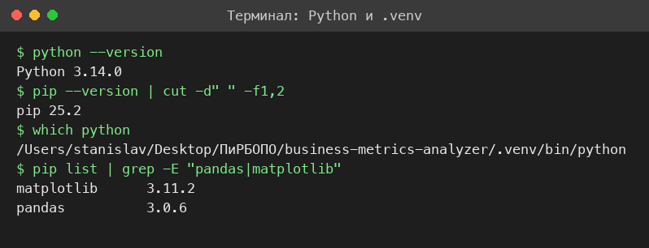
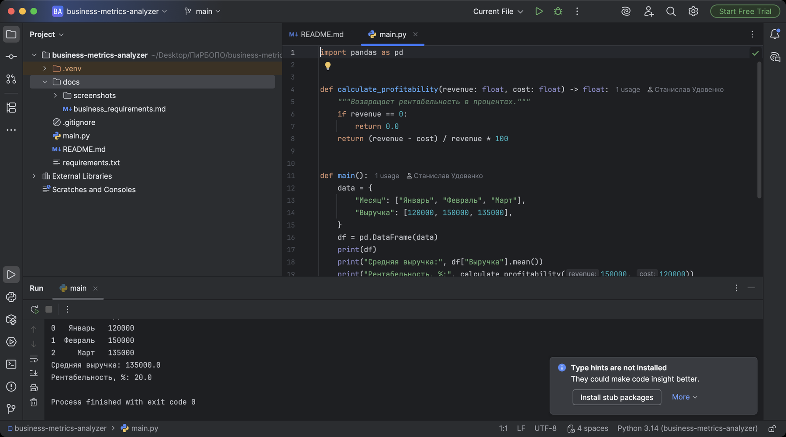
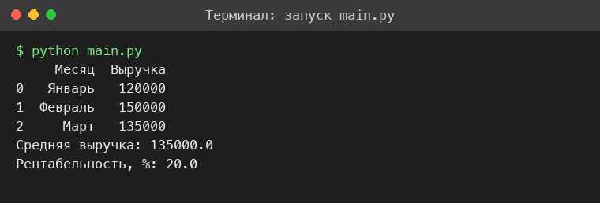
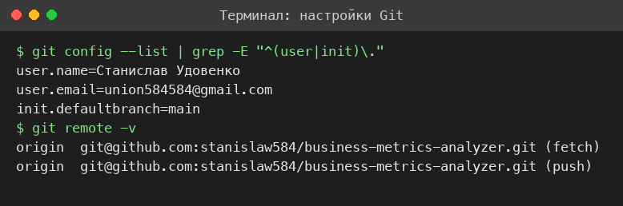
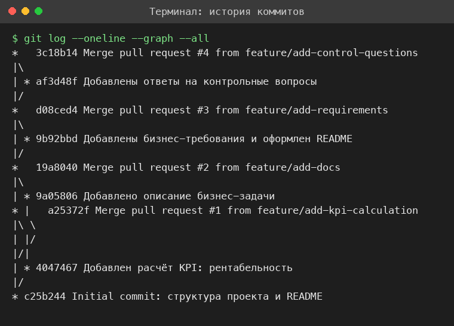
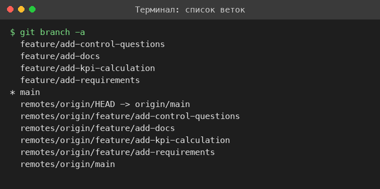
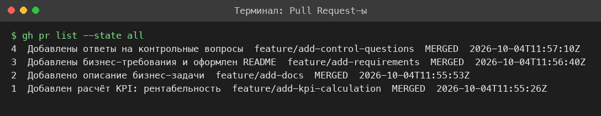
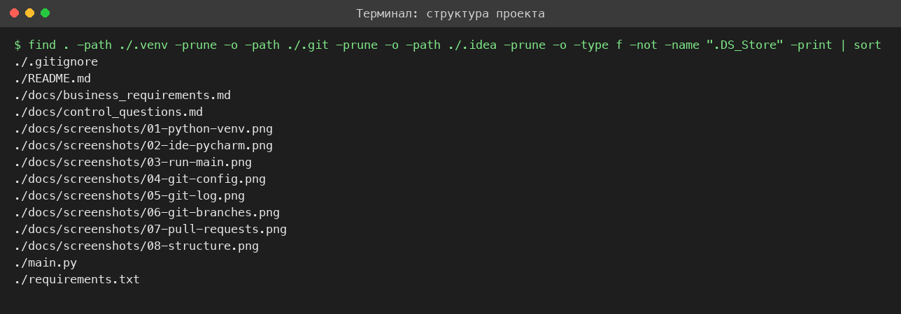

# Business Metrics Analyzer

Учебный проект по дисциплине «Проектирование и разработка бизнес-ориентированного программного обеспечения».

## Бизнес-задача

Расчёт и визуализация ключевых показателей эффективности (KPI) предприятия: выручки, рентабельности и динамики показателей по месяцам.

## Используемые технологии

- Python 3.12+
- pandas...
- matplotlib
- SQLAlchemy 2.0, Alembic (миграции), SQLite / PostgreSQL
- Faker (тестовые данные), pytest
- Git и GitHub (ветки, Pull Request)

## Планируемые метрики

- Выручка по месяцам и средняя выручка.
- Рентабельность, %.
- Динамика показателей (график matplotlib).

## Инструкция по запуску

```bash
python -m venv .venv
source .venv/bin/activate  # или .venv\Scripts\activate для Windows
pip install -r requirements.txt
python main.py
```

### База данных (ПЗ № 5)

```bash
cp .env.example .env              # Windows: copy .env.example .env
alembic upgrade head              # создать схему БД (SQLite по умолчанию)
python scripts/seed_data.py       # наполнить тестовыми данными (Faker, seed=42)
python -m pytest tests/ -v        # тесты запросов, моделей и наполнения
```

| Действие | Команда |
|---|---|
| Проверка подключения | `python scripts/check_connection.py` |
| Новая миграция | `alembic revision --autogenerate -m "описание"` |
| Откат на одну ревизию | `alembic downgrade -1` |
| История миграций | `alembic history` |
| Очистить таблицы перед повторным наполнением | `python scripts/reset_db.py` |

Для PostgreSQL достаточно установить `psycopg2-binary` и указать `DATABASE_URL` в `.env`.

## Структура проекта

```text
business-metrics-analyzer/
├── .env.example
├── .gitignore
├── README.md
├── requirements.txt
├── main.py
├── alembic.ini
├── pytest.ini
├── migrations/
│   ├── env.py
│   └── versions/
│       ├── 0001_create_initial_tables.py
│       └── 0002_add_product_description.py
├── src/
│   ├── database.py
│   ├── queries.py
│   └── models/
│       ├── __init__.py
│       ├── user.py, product.py, sale.py
│       └── kpi.py, report.py, metric_setting.py
├── scripts/
│   ├── check_connection.py
│   ├── seed_data.py
│   └── reset_db.py
├── tests/
│   ├── conftest.py
│   ├── test_queries.py
│   ├── test_models.py
│   └── test_seed.py
└── docs/
    ├── business_requirements.md
    ├── user_stories.md
    ├── use_cases.md
    ├── use_case_diagram.puml
    ├── draw_use_case.py
    ├── use_case_diagram.png
    ├── product_backlog.md
    ├── value_complexity_matrix.png
    ├── control_questions.md
    ├── control_questions_pz2.md
    ├── control_questions_pz4.md
    ├── control_questions_pz5.md
    ├── database/
    │   ├── er_diagram.png / er_diagram.puml
    │   └── schema.md
    ├── architecture/
    │   ├── README.md
    │   ├── context.puml / context.png
    │   ├── containers.puml / containers.png
    │   ├── components.puml / components.png
    │   ├── deployment.puml / deployment.png
    │   ├── draw_components.py, draw_deployment.py
    │   ├── patterns.md
    │   └── adr/
    │       └── ADR-001.md … ADR-005.md
    └── screenshots/
```

## Документация

- [Бизнес-требования](docs/business_requirements.md)
- [Ответы на контрольные вопросы (ПЗ № 1)](docs/control_questions.md)

### Практическое занятие № 2. Анализ требований и User Stories

- [Бизнес-требования, интервью, AS-IS / TO-BE](docs/business_requirements.md)
- [User Stories и критерии приёмки](docs/user_stories.md)
- [Use Case-диаграмма и описание Use Cases](docs/use_cases.md)
- [Product Backlog](docs/product_backlog.md)
- [Ответы на контрольные вопросы (ПЗ № 2)](docs/control_questions_pz2.md)

### Практическое занятие № 4. Архитектура

- [Архитектура: обзор, драйверы, стиль, диаграммы C4, компоненты, развёртывание](docs/architecture/README.md)
- [Паттерны проектирования](docs/architecture/patterns.md)
- [Architecture Decision Records (ADR)](docs/architecture/adr/)
- [Ответы на контрольные вопросы (ПЗ № 4)](docs/control_questions_pz4.md)

### Практическое занятие № 5. Проектирование и создание базы данных

- [Схема БД: таблицы, связи, индексы, нормализация, миграции](docs/database/schema.md)
- [ER-диаграмма](docs/database/er_diagram.png)
- Подключение: [src/database.py](src/database.py), модели: [src/models/](src/models/), миграции: [migrations/versions/](migrations/versions/)
- Запросы: [src/queries.py](src/queries.py), тестовые данные: [scripts/seed_data.py](scripts/seed_data.py), тесты: [tests/](tests/)
- [Ответы на контрольные вопросы (ПЗ № 5)](docs/control_questions_pz5.md)

## Результаты выполнения

### Python и виртуальное окружение



### Настройка IDE (PyCharm)



### Запуск main.py



### Настройки Git



### История коммитов



### Ветки



### Pull Request-ы



### Итоговая структура проекта



## Авторы

Студенты группы Б1123-38.03.05ба: Удовенко Станислав Романович, Тирон Артём Игоревич.
