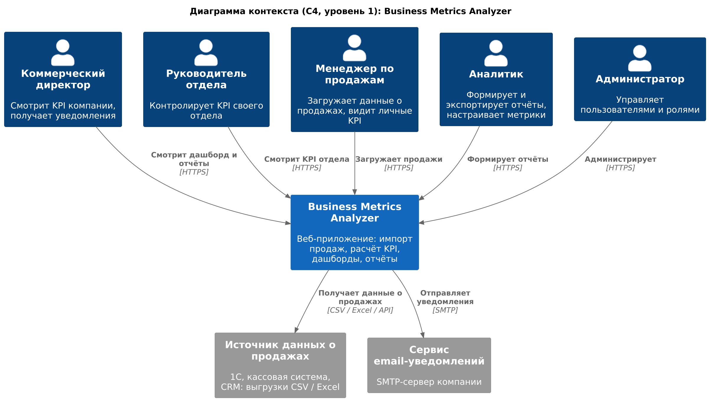
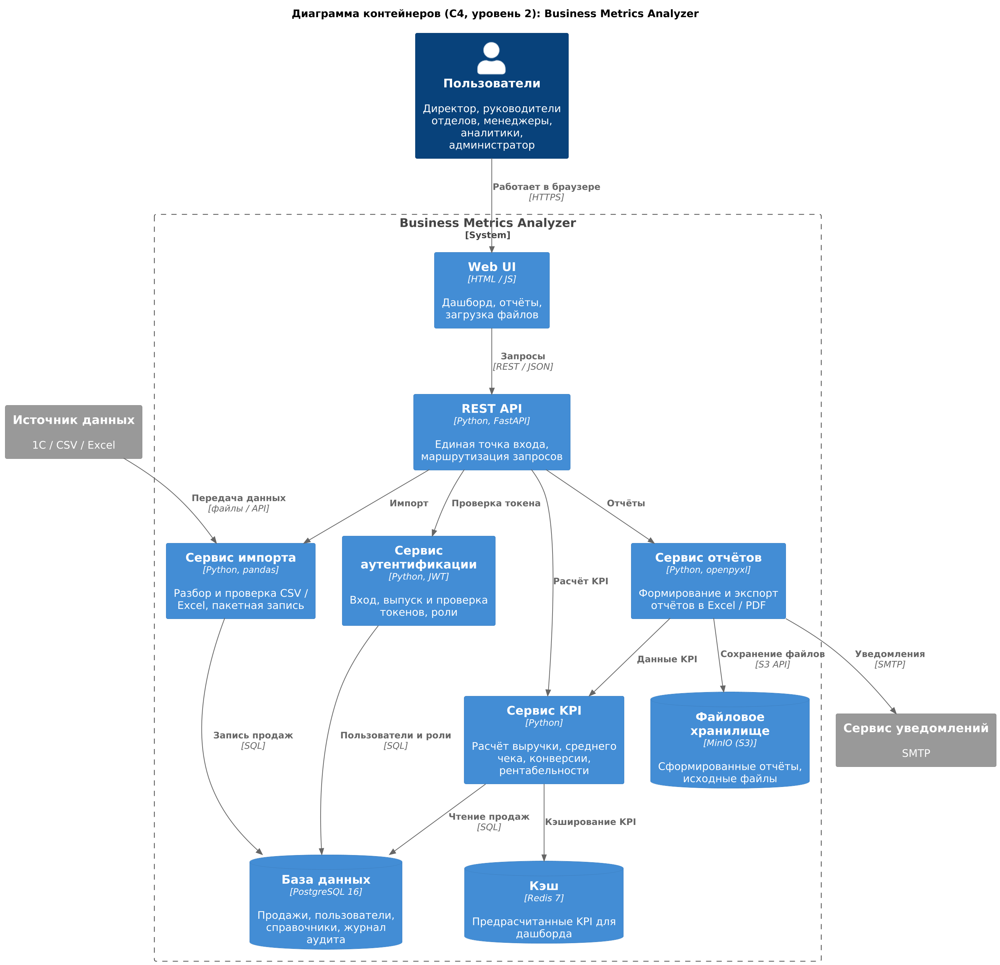
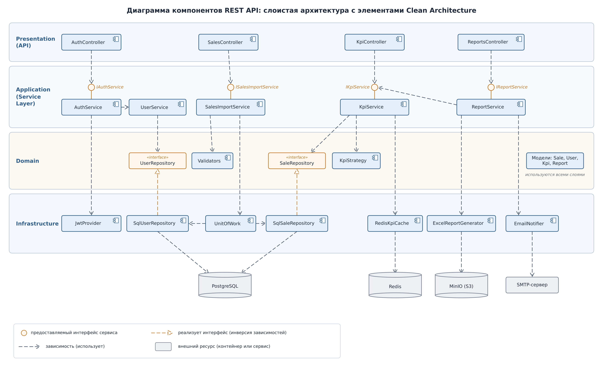
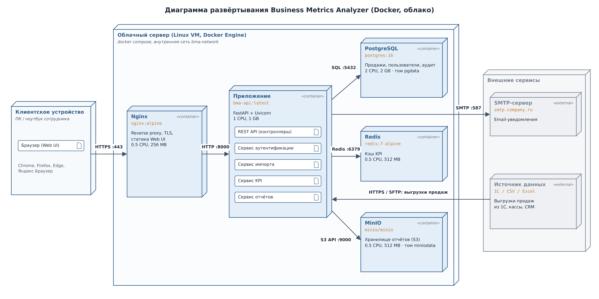

# Архитектура Business Metrics Analyzer

Практическое занятие № 4. Проектирование архитектуры приложения.

Исходные данные: [бизнес-требования](../business_requirements.md), [User Stories](../user_stories.md), [Use Case-диаграмма](../use_case_diagram.png), [Product Backlog](../product_backlog.md).

## 1. Обзор системы

Business Metrics Analyzer – веб-приложение для ООО «Ритейл-Аналитика», которое автоматически рассчитывает и визуализирует KPI продаж: выручку, средний чек, конверсию и рентабельность. Система заменяет ручную подготовку отчётов в Excel (2–3 дня) дашбордом с ежедневным обновлением.

**Границы системы.** В систему входят: веб-интерфейс, REST API, импорт данных о продажах, расчёт KPI, дашборды, формирование и экспорт отчётов, управление пользователями и ролями, настройка метрик, журнал аудита. Вне системы остаются: источник данных о продажах (1С, кассовая система, CRM) и почтовый сервер компании, с ними система взаимодействует через адаптеры.

**Функциональные области:**

1. аутентификация и управление пользователями (роли: директор, руководитель отдела, менеджер, аналитик, администратор);
2. загрузка и импорт данных о продажах (CSV, Excel, API 1С);
3. расчёт KPI (выручка, средний чек, конверсия, рентабельность);
4. визуализация и дашборды;
5. формирование и экспорт отчётов (Excel, PDF);
6. настройка метрик и справочников;
7. логирование и аудит действий.

## 2. Архитектурные драйверы

| ID | Драйвер | Тип | Приоритет | Влияние на архитектуру | Источник |
|---|---|---|---|---|---|
| AD-01 | Время отклика дашборда ≤ 3 с | Нефункциональный | Высокий | кэширование KPI в Redis, предрасчёт агрегатов после импорта, индексы по дате и отделу | NFR-01, AC-01.2 |
| AD-02 | Разграничение доступа по ролям | Нефункциональный | Высокий | отдельный сервис аутентификации, JWT, фильтрация данных по роли в Service Layer | NFR-02, US-04 |
| AD-03 | Импорт до 1 млн записей о продажах | Нефункциональный | Высокий | пакетная запись через Unit of Work, фоновая обработка импорта, отчёт об ошибочных строках | FR-01, NFR-05 |
| AD-04 | Быстрый MVP за 3 спринта командой из 4 человек | Бизнес | Высокий | монолит со слоистой архитектурой, одно развёртываемое приложение | CN-01, CN-02 |
| AD-05 | Новые KPI и форматы отчётов без переписывания кода | Функциональный | Средний | паттерны Strategy и Factory, настройка метрик в справочнике | FR-09, US-08 |
| AD-06 | Разные источники данных (1С, CSV, Excel) | Функциональный | Средний | паттерн Adapter, единый формат `SaleRecord` | FR-01, CN-05 |
| AD-07 | Данные о продажах не покидают периметр компании | Ограничение | Высокий | развёртывание в Docker на сервере компании или в частном облаке, MinIO вместо внешнего S3 | CN-04 |
| AD-08 | Журнал действий пользователей | Нефункциональный | Средний | журнал аудита в PostgreSQL, запись через подписчика событий (Observer) | функциональная область 7 |

Исходя из таблицы, сильнее всего на архитектуру влияют производительность дашборда, безопасность и сроки MVP: они определяют выбор монолита, кэша и отдельного модуля аутентификации.

## 3. Выбранный архитектурный стиль

**Слоистый монолит с элементами Clean Architecture.** Приложение развёртывается одним контейнером `bma-api`, внутри разделено на четыре слоя: Presentation, Application, Domain, Infrastructure. Зависимости направлены внутрь: слой Domain не зависит ни от FastAPI, ни от SQLAlchemy, а интерфейсы репозиториев объявлены в Domain и реализуются в Infrastructure (инверсия зависимостей).

Обоснование:

- команда небольшая (4 человека), один репозиторий и одно приложение проще разрабатывать и сопровождать;
- MVP нужен за 6 недель, монолит не требует оркестрации, межсервисной сети и распределённых транзакций;
- бизнес-логика расчёта KPI отделена от инфраструктуры и тестируется без базы данных;
- сервисы на диаграмме контейнеров – это модули монолита с чёткими интерфейсами, поэтому позже любой из них (например, сервис отчётов) можно вынести в отдельный микросервис.

Сравнение альтернатив и последствия решения описаны в [ADR-001](adr/ADR-001.md).

## 4. Диаграммы

### 4.1 Контекст (C4, уровень 1)

Исходник: [context.puml](context.puml) (C4-PlantUML).

### 4.2 Контейнеры (C4, уровень 2)

Исходник: [containers.puml](containers.puml) (C4-PlantUML). Сервисы аутентификации, импорта, KPI и отчётов на этапе MVP – модули одного приложения `bma-api`, а не отдельные процессы (см. раздел 3).

### 4.3 Компоненты

Исходники: [components.puml](components.puml) (PlantUML), иллюстрация построена скриптом [draw_components.py](draw_components.py).

Интерфейсы ключевых компонентов:

| Компонент | Интерфейс | Методы |
|---|---|---|
| AuthService | IAuthService | `login(username, password) -> TokenDto`, `verify_token(token) -> CurrentUser`, `refresh(token) -> TokenDto` |
| UserService | IUserService | `create_user(dto) -> UserDto`, `block_user(user_id) -> None`, `assign_role(user_id, role) -> None` |
| SalesImportService | ISalesImportService | `import_file(file, source_type) -> ImportResult`, `validate(records) -> ValidationResult` |
| KpiService | IKpiService | `calculate_period(period, department=None) -> KpiResult`, `get_dashboard(period, user) -> DashboardDto`, `compare(period, previous) -> KpiComparisonDto` |
| ReportService | IReportService | `generate(report_type, period) -> ReportFile`, `export_excel(report_id) -> bytes` |
| SaleRepository | SaleRepository | `add_many(records) -> None`, `get_by_period(start, end, department=None) -> list[SaleRecord]` |
| UnitOfWork | контекстный менеджер | `__enter__() -> UnitOfWork`, `__exit__(...)`: `commit` или `rollback` |

### 4.4 Развёртывание

Исходники: [deployment.puml](deployment.puml) (PlantUML), иллюстрация построена скриптом [draw_deployment.py](draw_deployment.py).

| Узел | Образ / ПО | Ресурсы | Порт | Назначение |
|---|---|---|---|---|
| Nginx | nginx:alpine | 0.5 CPU, 256 MB | 443 | reverse proxy, TLS, раздача статики Web UI |
| App | bma-api:latest (FastAPI + Uvicorn) | 1 CPU, 1 GB | 8000 | REST API и бизнес-логика |
| PostgreSQL | postgres:16 | 2 CPU, 2 GB, том `pgdata` | 5432 | хранение продаж, пользователей, справочников, аудита |
| Redis | redis:7-alpine | 0.5 CPU, 512 MB | 6379 | кэш KPI |
| MinIO | minio/minio | 0.5 CPU, 512 MB, том `miniodata` | 9000 | хранение сформированных отчётов |

Исходя из таблицы, суммарно системе нужно 4.5 CPU и 4.25 GB памяти, то есть одна виртуальная машина среднего размера. Наружу открыт только порт 443 Nginx, остальные контейнеры доступны лишь во внутренней сети Docker `bma-network`.

## 5. Слои и компоненты

| Слой | Компоненты | Ответственность |
|---|---|---|
| Presentation (API) | `AuthController`, `SalesController`, `KpiController`, `ReportsController`, Pydantic-схемы (DTO) | обработка HTTP-запросов, валидация входных данных, проверка JWT, сериализация ответов |
| Application (Service Layer) | `AuthService`, `UserService`, `SalesImportService`, `KpiService`, `ReportService` | бизнес-сценарии из User Stories, транзакции, проверка прав по роли |
| Domain | модели `Sale`, `User`, `Kpi`, `Report`; `KpiStrategy`; `Validators`; интерфейсы `SaleRepository`, `UserRepository` | бизнес-правила и формулы KPI, не зависит от фреймворков |
| Infrastructure | `SqlSaleRepository`, `SqlUserRepository`, `UnitOfWork`, `JwtProvider`, `RedisKpiCache`, `ExcelReportGenerator`, `EmailNotifier`, адаптеры источников | доступ к данным, кэш, файлы, внешние системы |

Правило зависимостей: слой может обращаться только к слоям ниже себя, а Infrastructure реализует интерфейсы Domain. Поэтому замена PostgreSQL или почтового сервиса затрагивает только Infrastructure.

## 6. Используемые паттерны

Repository, Unit of Work, Service Layer, Strategy, Factory, DTO, Adapter, Observer. Таблица с обоснованием и фрагменты кода на Python: [patterns.md](patterns.md).

## 7. Технологический стек

| Назначение | Технология |
|---|---|
| Язык | Python 3.12 |
| Веб-фреймворк, API | FastAPI, Uvicorn, Pydantic |
| Доступ к данным | SQLAlchemy 2, Alembic (миграции) |
| Обработка данных | pandas |
| Отчёты | openpyxl (Excel), reportlab (PDF) |
| Аутентификация | JWT (PyJWT), bcrypt |
| База данных | PostgreSQL 16 |
| Кэш | Redis 7 |
| Хранилище файлов | MinIO (S3-совместимое) |
| Веб-сервер | Nginx |
| Контейнеризация | Docker, docker compose |
| Контроль версий | Git, GitHub (ветки, Pull Request) |

## 8. Ограничения и компромиссы

- **Монолит** ускоряет MVP, но масштабируется только целиком: при росте нагрузки на отчёты придётся масштабировать всё приложение;
- **кэш Redis** даёт отклик дашборда ≤ 3 с, но добавляет риск устаревших данных, поэтому кэш сбрасывается после каждого импорта (событие `SalesImported`);
- **фоновый импорт** выполняется в том же процессе (`BackgroundTasks` FastAPI), без отдельной очереди задач: проще для MVP, но длинный импорт занимает ресурсы API;
- **JWT без сессий на сервере** упрощает масштабирование, но отозвать токен до истечения срока нельзя, поэтому срок жизни токена ограничен 30 минутами с обновлением через refresh-токен;
- **только файлы CSV / Excel** на первом этапе (ограничение CN-05), API 1С подключается через адаптер в следующих релизах;
- **одна виртуальная машина** без резервирования: доступность 99% в рабочее время достигается, но при отказе сервера нужно восстановление из резервной копии.

## 9. План развития архитектуры

1. Спринт 4: вынести фоновый импорт в очередь задач (Celery или RQ поверх Redis), добавить адаптер API 1С.
2. Выделить сервис отчётов в отдельный контейнер: он независим по данным (читает KPI через API) и нагружает CPU при формировании PDF.
3. Добавить реплику PostgreSQL только для чтения под дашборды и отчёты.
4. При росте числа пользователей перейти с docker compose на Kubernetes и запускать несколько экземпляров `bma-api` за балансировщиком.
5. Мобильная версия (US-10) – отдельный клиент поверх существующего REST API, изменения серверной архитектуры не требуются.

## 10. Ссылки на ADR

| ADR | Решение | Статус |
|---|---|---|
| [ADR-001](adr/ADR-001.md) | Слоистый монолит с элементами Clean Architecture | Принято |
| [ADR-002](adr/ADR-002.md) | PostgreSQL как основная СУБД | Принято |
| [ADR-003](adr/ADR-003.md) | Аутентификация по JWT с ролевым доступом | Принято |
| [ADR-004](adr/ADR-004.md) | Кэширование KPI в Redis | Принято |
| [ADR-005](adr/ADR-005.md) | Асинхронный пакетный импорт данных | Принято |

## Авторы

Студенты группы Б1123-38.03.05ба: Удовенко Станислав Романович, Тирон Артём Игоревич.
