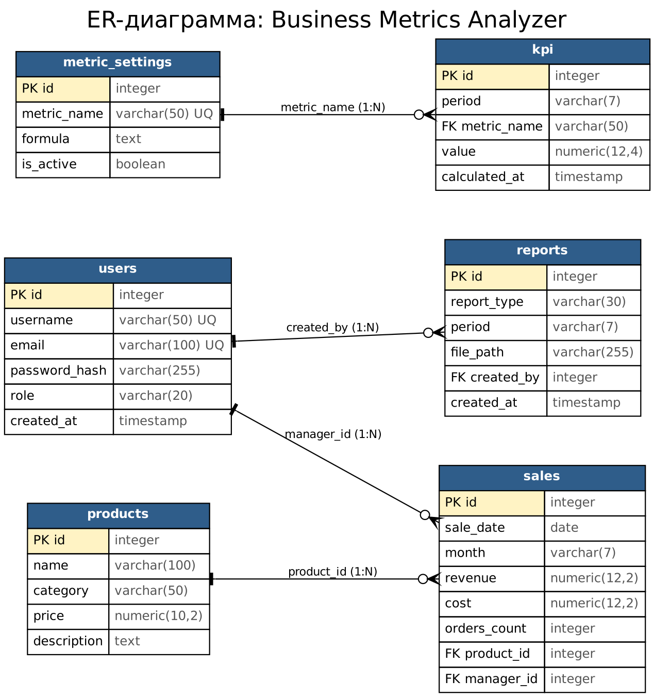

# Схема базы данных Business Metrics Analyzer

## 1. ER-диаграмма

Исходник в PlantUML: [er_diagram.puml](./er_diagram.puml).

Целевая СУБД по [ADR-002](../architecture/adr/ADR-002.md) — PostgreSQL. Для учебного прототипа и тестов по умолчанию используется SQLite: строка подключения задаётся переменной `DATABASE_URL`, модели и миграции одинаковы для обеих СУБД.

## 2. Таблицы

### users
| Колонка | Тип | Ограничения | Описание |
|---|---|---|---|
| id | INTEGER | PK, autoincrement | Идентификатор |
| username | VARCHAR(50) | UNIQUE, NOT NULL | Логин |
| email | VARCHAR(100) | UNIQUE, NOT NULL | Электронная почта |
| password_hash | VARCHAR(255) | NOT NULL | Хэш пароля |
| role | VARCHAR(20) | NOT NULL, CHECK (director / manager / analyst / admin) | Роль |
| created_at | TIMESTAMP | server_default now | Дата создания |

### products
| Колонка | Тип | Ограничения | Описание |
|---|---|---|---|
| id | INTEGER | PK | Идентификатор |
| name | VARCHAR(100) | NOT NULL | Название |
| category | VARCHAR(50) | NOT NULL | Категория |
| price | NUMERIC(10,2) | NOT NULL, CHECK ≥ 0 | Цена |
| description | TEXT | NULL | Описание (добавлено миграцией 0002) |

### sales
| Колонка | Тип | Ограничения | Описание |
|---|---|---|---|
| id | INTEGER | PK | Идентификатор продажи |
| sale_date | DATE | NOT NULL | Дата продажи |
| month | VARCHAR(7) | NOT NULL, INDEX | Месяц `YYYY-MM` |
| revenue | NUMERIC(12,2) | NOT NULL, CHECK ≥ 0 | Выручка |
| cost | NUMERIC(12,2) | NOT NULL, CHECK ≥ 0 | Себестоимость |
| orders_count | INTEGER | NOT NULL, default 1, CHECK ≥ 1 | Число заказов |
| product_id | INTEGER | FK → products.id, NOT NULL | Товар |
| manager_id | INTEGER | FK → users.id, NOT NULL | Менеджер |

### metric_settings
| Колонка | Тип | Ограничения | Описание |
|---|---|---|---|
| id | INTEGER | PK | Идентификатор |
| metric_name | VARCHAR(50) | UNIQUE, NOT NULL | Код метрики |
| formula | TEXT | NOT NULL | Формула расчёта |
| is_active | BOOLEAN | NOT NULL, default true | Метрика включена |

### kpi
| Колонка | Тип | Ограничения | Описание |
|---|---|---|---|
| id | INTEGER | PK | Идентификатор |
| period | VARCHAR(7) | NOT NULL | Период `YYYY-MM` |
| metric_name | VARCHAR(50) | FK → metric_settings.metric_name, NOT NULL | Метрика |
| value | NUMERIC(12,4) | NOT NULL | Значение |
| calculated_at | TIMESTAMP | server_default now | Когда рассчитано |

Составной уникальный ключ `(period, metric_name)`: одна метрика за период хранится один раз (кэш).

### reports
| Колонка | Тип | Ограничения | Описание |
|---|---|---|---|
| id | INTEGER | PK | Идентификатор |
| report_type | VARCHAR(30) | NOT NULL | Тип отчёта |
| period | VARCHAR(7) | NOT NULL | Период |
| file_path | VARCHAR(255) | NOT NULL | Путь к файлу |
| created_by | INTEGER | FK → users.id, NOT NULL | Автор |
| created_at | TIMESTAMP | server_default now | Дата создания |

## 3. Связи

| Родительская таблица | Дочерняя таблица | Тип | Ключ |
|---|---|---|---|
| users | sales | 1:N | sales.manager_id → users.id |
| products | sales | 1:N | sales.product_id → products.id |
| users | reports | 1:N | reports.created_by → users.id |
| metric_settings | kpi | 1:N | kpi.metric_name → metric_settings.metric_name |

Связей N:M в модели нет. Удаление родительской записи, на которую есть ссылки, запрещено (RESTRICT по умолчанию).

## 4. Индексы

| Таблица | Индекс | Назначение |
|---|---|---|
| sales | idx_sales_month | Ускорение запросов по месяцу |
| sales | idx_sales_manager_id | Выборки по менеджеру, JOIN с users |
| sales | idx_sales_product_id | Выборки по товару, JOIN с products |
| kpi | uq_kpi_period_metric | Уникальность KPI за период, быстрый поиск |

## 5. Нормализация

- **1НФ**: все атрибуты атомарны, у каждой таблицы есть первичный ключ.
- **2НФ**: во всех таблицах простой первичный ключ `id`, частичных зависимостей нет.
- **3НФ**: данные о товаре (название, категория, цена) вынесены в `products`, данные о менеджере — в `users`, формулы метрик — в `metric_settings`. В `sales` хранятся только факты продажи и ключи. Транзитивных зависимостей нет.
- **Осознанное исключение**: `sales.month` производно от `sale_date`. Столбец сохранён для быстрой группировки и индекса по месяцу (запросы KPI всегда идут по месяцу). Согласованность обеспечивает код наполнения (`sale_date.strftime("%Y-%m")`).
- `kpi` — кэш вычисляемых значений, хранится по требованию бизнес-правил.
- `kpi.metric_name` ссылается на естественный ключ `metric_settings.metric_name` (он UNIQUE), как требует задание.

## 6. Миграции

| Ревизия | Описание | Дата |
|---|---|---|
| 0001 | Создание начальных таблиц | 2026-11-19 |
| 0002 | Добавление `products.description` | 2026-11-19 |

Проверка внешних ключей в SQLite (`PRAGMA foreign_keys=ON`) включается для соединений приложения в `src/database.py`; на DDL миграций она не влияет.
