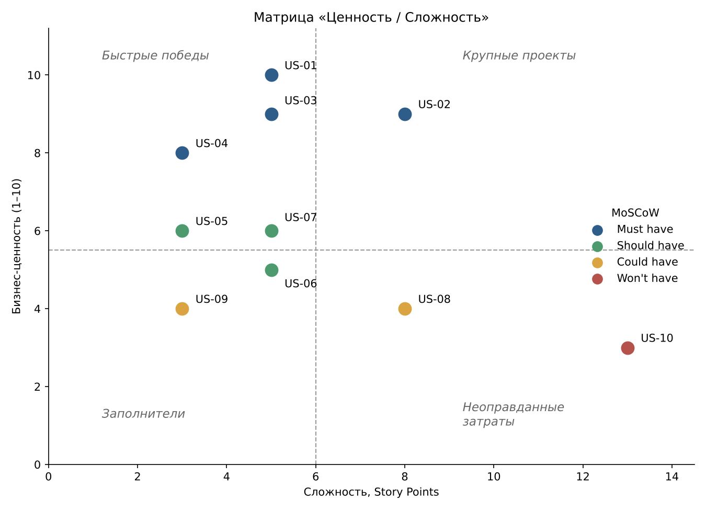

# Product Backlog – Business Metrics Analyzer

Backlog сформирован из [User Stories](user_stories.md) и приоритизирован методом MoSCoW с оценкой в Story Points (шкала Фибоначчи: 1, 2, 3, 5, 8, 13). Длительность спринта – 2 недели.

| ID | User Story | Приоритет | Story Points | Спринт | Статус |
|---|---|---|---|---|---|
| US-01 | Просмотр дашборда KPI | Must have | 5 | 1 | To Do |
| US-02 | Формирование отчёта по KPI | Must have | 8 | 1 | To Do |
| US-03 | Загрузка данных о продажах | Must have | 5 | 1 | To Do |
| US-04 | Авторизация и разграничение доступа | Must have | 3 | 1 | To Do |
| US-05 | Экспорт отчёта в Excel | Should have | 3 | 2 | To Do |
| US-06 | Управление пользователями | Should have | 5 | 2 | To Do |
| US-07 | Сравнение KPI с предыдущим периодом | Should have | 5 | 2 | To Do |
| US-08 | Настройка метрик и целевых значений | Could have | 8 | 3 | To Do |
| US-09 | Уведомления о снижении KPI | Could have | 3 | 3 | To Do |
| US-10 | Мобильная версия | Won't have | 13 | – | Отложено |

## Приоритизация MoSCoW

- **Must have** (US-01–US-04) – без загрузки данных, расчёта KPI, дашборда, отчёта и авторизации система не решает главную проблему заказчика (BR-01–BR-03) и не может быть запущена;
- **Should have** (US-05–US-07) – важны для работы руководства, но запуск можно провести и без них: отчёт пока смотрят на экране, пользователей заводят через базу данных;
- **Could have** (US-08, US-09) – повышают ценность системы, но не обязательны для первого релиза;
- **Won't have** (US-10) – заказчик подтвердил, что в первую очередь нужна веб-версия для компьютера, мобильная версия переносится в следующий релиз.

## План спринтов

| Спринт | Цель спринта | User Stories | Story Points |
|---|---|---|---|
| 1 (недели 1–2) | MVP: загрузить данные и увидеть KPI | US-01, US-02, US-03, US-04 | 21 |
| 2 (недели 3–4) | Отчётность для руководства и администрирование | US-05, US-06, US-07 | 13 |
| 3 (недели 5–6) | Контроль выполнения плана | US-08, US-09 | 11 |
| – | Следующий релиз | US-10 | 13 |
| **Итого в релизе** | | 9 историй | **45** |

Спринт 1 самый загруженный, так как в него входят все Must have. Если команда не успевает, первой переносится US-04 в части блокировки после неудачных попыток входа (AC-04.3).

## Матрица «Ценность / Сложность»

Ценность оценена по шкале 1–10 по вкладу в бизнес-требования, сложность – в Story Points.

| ID | User Story | Ценность (1–10) | Сложность (SP) | Квадрант |
|---|---|---|---|---|
| US-01 | Дашборд KPI | 10 | 5 | Быстрые победы |
| US-03 | Загрузка данных | 9 | 5 | Быстрые победы |
| US-04 | Авторизация | 8 | 3 | Быстрые победы |
| US-02 | Формирование отчёта | 9 | 8 | Крупные проекты |
| US-05 | Экспорт в Excel | 6 | 3 | Быстрые победы |
| US-07 | Сравнение периодов | 6 | 5 | Быстрые победы |
| US-06 | Управление пользователями | 5 | 5 | Заполнители |
| US-09 | Уведомления | 4 | 3 | Заполнители |
| US-08 | Настройка метрик | 4 | 8 | Неоправданные затраты |
| US-10 | Мобильная версия | 3 | 13 | Неоправданные затраты |

Исходя из матрицы, истории с высокой ценностью и небольшой сложностью (US-01, US-03, US-04) берутся в первый спринт. US-02 сложная, но без неё не решается главная проблема заказчика, поэтому она тоже в спринте 1. US-08 и US-10 при невысокой ценности требуют много усилий, поэтому они в конце backlog. Результат матрицы совпадает с приоритизацией MoSCoW, что подтверждает её обоснованность.
