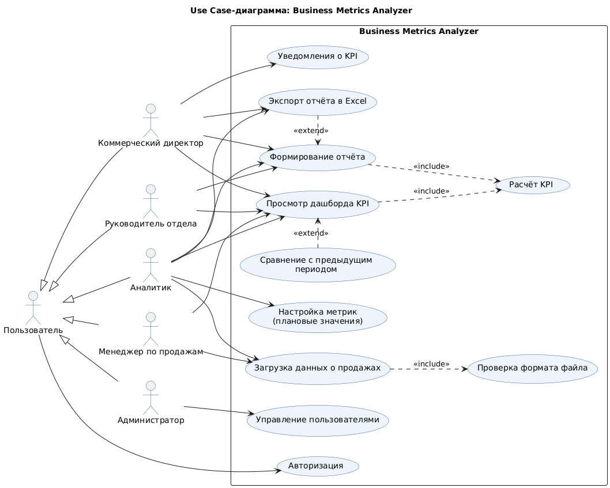

# Use Cases – Business Metrics Analyzer

## Use Case-диаграмма

Исходный код диаграммы: [use_case_diagram.puml](use_case_diagram.puml) (PlantUML).

### Акторы

| Актор | Описание |
|---|---|
| Пользователь | обобщённый актор, любой сотрудник с учётной записью |
| Коммерческий директор | заказчик, просматривает KPI всей компании, получает уведомления |
| Руководитель отдела | просматривает KPI и отчёты своего отдела |
| Менеджер по продажам | загружает данные о продажах, видит личные показатели |
| Аналитик | загружает данные, формирует и экспортирует отчёты, настраивает метрики |
| Администратор | управляет пользователями и ролями |

### Соответствие Use Cases и User Stories

| Use Case | User Story |
|---|---|
| Просмотр дашборда KPI | US-01 |
| Формирование отчёта | US-02 |
| Загрузка данных о продажах | US-03 |
| Авторизация | US-04 |
| Экспорт отчёта в Excel | US-05 |
| Управление пользователями | US-06 |
| Сравнение с предыдущим периодом | US-07 |
| Настройка метрик (плановые значения) | US-08 |
| Уведомления о KPI | US-09 |

Связь `<<include>>` показывает обязательную часть сценария (расчёт KPI выполняется при каждом просмотре дашборда и формировании отчёта, проверка формата – при каждой загрузке). Связь `<<extend>>` показывает необязательное расширение (экспорт и сравнение пользователь вызывает по желанию).

## Текстовое описание ключевых Use Cases

### UC-02. Формирование отчёта

| Поле | Значение |
|---|---|
| Название | Формирование отчёта |
| Актор | Аналитик (также коммерческий директор, руководитель отдела) |
| Предусловие | Пользователь авторизован, данные о продажах за период загружены |
| Основной поток | 1. Пользователь открывает раздел «Отчёты».   2. Выбирает тип отчёта (по отделам, по менеджерам, по периодам).   3. Указывает период.   4. Нажимает «Сформировать».   5. Система рассчитывает KPI (include «Расчёт KPI») с учётом прав пользователя.   6. Система отображает отчёт в виде таблицы и графика.   7. Пользователь просматривает отчёт |
| Альтернативный поток | 4а. Если данных за период нет – система выводит сообщение «За выбранный период данные отсутствуют» и возвращает к шагу 3.   5а. Если выручка отдела равна нулю – рентабельность отображается как 0%.   7а. Пользователь нажимает «Экспорт в Excel» (extend «Экспорт отчёта в Excel») |
| Постусловие | Отчёт сформирован и доступен для экспорта |

### UC-03. Загрузка данных о продажах

| Поле | Значение |
|---|---|
| Название | Загрузка данных о продажах |
| Актор | Менеджер по продажам, аналитик |
| Предусловие | Пользователь авторизован, есть файл выгрузки CSV или Excel |
| Основной поток | 1. Пользователь открывает раздел «Загрузка данных».   2. Выбирает файл и нажимает «Загрузить».   3. Система проверяет формат файла и наличие обязательных колонок (include «Проверка формата файла»).   4. Система сохраняет корректные строки.   5. Система выводит сообщение «Загружено N строк» и обновляет KPI |
| Альтернативный поток | 3а. Если файл не CSV/Excel – система отклоняет его с сообщением «Поддерживаются только CSV и Excel».   3б. Если отсутствуют обязательные колонки – система выводит список недостающих колонок, данные не сохраняются.   4а. Если часть строк некорректна – сохраняются только корректные, ошибочные выводятся в отчёте о загрузке |
| Постусловие | Данные сохранены, KPI на дашборде пересчитаны |
